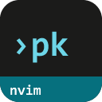
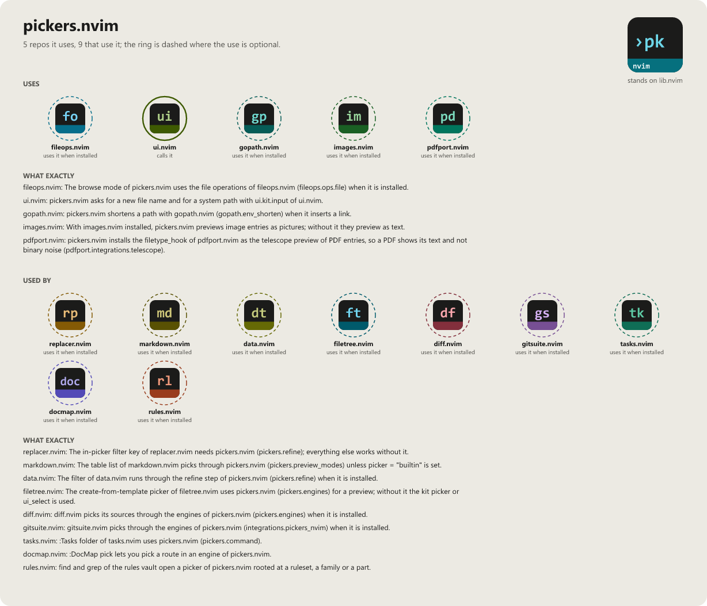

> **Beta stage — active development.** This repository is past its first shape and in
> active use, but the surface is not frozen: breaking changes are still possible. Pin a
> commit or tag if you depend on it.

# pickers.nvim

```
██████╗ ██╗ ██████╗██╗  ██╗███████╗██████╗ ███████╗
██╔══██╗██║██╔════╝██║ ██╔╝██╔════╝██╔══██╗██╔════╝
██████╔╝██║██║     █████╔╝ █████╗  ██████╔╝███████╗
██╔═══╝ ██║██║     ██╔═██╗ ██╔══╝  ██╔══██╗╚════██║
██║     ██║╚██████╗██║  ██╗███████╗██║  ██║███████║
╚═╝     ╚═╝ ╚═════╝╚═╝  ╚═╝╚══════╝╚═╝  ╚═╝╚══════╝
                                        · n v i m ·
```

[](LICENSE)
[](https://neovim.io)
[](https://www.lua.org)

[](https://github.com/WKDSteve/pickers.nvim/actions/workflows/ci.yml)
[](https://wkdsteve.github.io/wkd/p/pickers/)

> Part of the [wkd](https://wkdsteve.github.io/wkd/) family — see this plugin's [page](https://wkdsteve.github.io/wkd/p/pickers/) on the site.

One `:Pickers` command over telescope.nvim, fzf-lua and snacks.nvim. Seven
separate picker modules consolidated into one grammar —
`:Pickers <scope> <action>` — with the engine auto-detected and every scope,
action and native picker completing with `<Tab>`.

---

## Around it

> **[insights.nvim](https://github.com/WKDSteve/insights.nvim)** — the next
> question after the jump: pickers gets you into a repository, insights tells
> you how it is put together.
>
> **[images.nvim](https://github.com/WKDSteve/images.nvim)** — draws an
> image entry in the preview window as a picture instead of as bytes.
>
> **[pdfport.nvim](https://github.com/WKDSteve/pdfport.nvim)** — the same
> for a `.pdf` entry, previewed as its first page.
>
> **[filetree.nvim](https://github.com/WKDSteve/filetree.nvim)** — its `f`
> (find files) and `gr` (grep) on a tree node run through this plugin, and the
> picked file is revealed in the tree. On by default; either end can opt out
> ([details](docs/FEATURES/FILETREE.md)).
>
> All of the above are soft: without them everything else works unchanged.
> [lib.nvim](https://github.com/WKDSteve/lib.nvim) and one picker engine are
> the real dependencies — see [Requirements](docs/installation.md#requirements).

---

## Documentation

Start at [docs/README.md](docs/README.md), which says what is where and which
question each page answers.

### The Basics

- [Requirements](docs/installation.md#requirements) — Neovim version, required plugins and CLI tools.
- [Installation](docs/installation.md) — the recommended spec and the lazy-loading variant, per plugin manager.
- [Quickstart](docs/quickstart.md) — the first thing to run after installing.

### Configuration

- [What you get with the defaults](docs/what-you-get.md) — the scopes and default keys at a glance.
- [All options](docs/configuration.md) — every `setup()` option and its default. All of them are optional, so it doubles as the list of what happens if you set nothing.
- [Command reference](docs/commands.md) — `:Pickers` argument by argument, the scopes, the smart action, and the compat aliases.
- [Cheatsheet](docs/cheatsheet.md) — the command syntax, the scopes and the keys on one screen.
- [Keymaps](docs/keymaps.md) / [Bindings cheatsheet](docs/BINDINGS.md)

### The Rest

- [Features](docs/FEATURES/README.md) — one page per area: [engines](docs/FEATURES/ENGINES.md), [scopes](docs/FEATURES/SCOPES.md), [actions](docs/FEATURES/ACTIONS.md), [native pickers](docs/FEATURES/BUILTINS.md), [keys](docs/FEATURES/KEYS.md), [UI](docs/FEATURES/UI.md), [persistence](docs/FEATURES/PERSISTENCE.md), [refine](docs/FEATURES/REFINE.md), [images and PDFs](docs/FEATURES/IMAGES.md), [filetree.nvim](docs/FEATURES/FILETREE.md).
- [Built-in pickers](docs/builtins.md) — every `:Pickers builtin <name>`, and the per-engine parity matrix.
- [Collections](docs/collections.md) — user-defined named scopes: what a collection is, and how to define one.
- [Workflow](docs/WORKFLOW.md) — how scopes, collections and engines combine into a way of working, and the traps table worth reading before you hit one.
- [Changelog](docs/CHANGELOG.md) — what changed, in the order it happened.
- [Contributing](docs/CONTRIBUTING.md) — ground rules, project layout, and how to add a scope, an action or an engine.
- [Feedback](https://github.com/WKDSteve/pickers.nvim/issues) — bugs, feature requests and usage questions; broader discussion in [Discussions](https://github.com/WKDSteve/pickers.nvim/discussions).

`:help pickers` is the same reference inside the editor. When something does
not behave the way the config says it should, there is no separate
troubleshooting page on purpose — start at
[WORKFLOW.md §8](docs/WORKFLOW.md#8-traps-worth-knowing-before-you-hit-them)
and `:checkhealth pickers`.

---

## License

[](LICENSE)

pickers.nvim is released under the [MIT License](https://opensource.org/licenses/MIT).

<!-- connections:begin (written by the app-icons tool of the workshop; change integrations.json there, not this block) -->
## Connections



**Uses**

- [fileops.nvim](https://github.com/WKDSteve/fileops.nvim): The browse mode of pickers.nvim uses the file operations of fileops.nvim (`fileops.ops.file`) when it is installed. ([picture](assets/graphs/pair/pickers.nvim--fileops.nvim.png))
- [gopath.nvim](https://github.com/WKDSteve/gopath.nvim): pickers.nvim shortens a path with gopath.nvim (`gopath.env_shorten`) when it inserts a link. ([picture](assets/graphs/pair/pickers.nvim--gopath.nvim.png))
- [images.nvim](https://github.com/WKDSteve/images.nvim): With images.nvim installed, pickers.nvim previews image entries as pictures; without it they preview as text. ([picture](assets/graphs/pair/pickers.nvim--images.nvim.png))
- [pdfport.nvim](https://github.com/WKDSteve/pdfport.nvim): pickers.nvim installs the `filetype_hook` of pdfport.nvim as the telescope preview of PDF entries, so a PDF shows its text and not binary noise (`pdfport.integrations.telescope`). ([picture](assets/graphs/pair/pickers.nvim--pdfport.nvim.png))
- [ui.nvim](https://github.com/WKDSteve/ui.nvim): pickers.nvim asks for a new file name and for a system path with `ui.kit.input` of ui.nvim. ([picture](assets/graphs/pair/pickers.nvim--ui.nvim.png))
- [lib.nvim](https://github.com/WKDSteve/lib.nvim): the shared base of the plugins.

**Used by**

- [data.nvim](https://github.com/WKDSteve/data.nvim): The filter of data.nvim runs through the refine step of pickers.nvim (`pickers.refine`) when it is installed. ([picture](assets/graphs/pair/data.nvim--pickers.nvim.png))
- [diff.nvim](https://github.com/WKDSteve/diff.nvim): diff.nvim picks its sources through the engines of pickers.nvim (`pickers.engines`) when it is installed. ([picture](assets/graphs/pair/diff.nvim--pickers.nvim.png))
- [docmap.nvim](https://github.com/WKDSteve/docmap.nvim): `:DocMap pick` lets you pick a route in an engine of pickers.nvim. ([picture](assets/graphs/pair/docmap.nvim--pickers.nvim.png))
- [filetree.nvim](https://github.com/WKDSteve/filetree.nvim): The create-from-template picker of filetree.nvim uses pickers.nvim (`pickers.engines`) for a preview; without it the kit picker or `ui_select` is used. ([picture](assets/graphs/pair/filetree.nvim--pickers.nvim.png))
- [gitsuite.nvim](https://github.com/WKDSteve/gitsuite.nvim): gitsuite.nvim picks through the engines of pickers.nvim (`integrations.pickers_nvim`) when it is installed. ([picture](assets/graphs/pair/gitsuite.nvim--pickers.nvim.png))
- [markdown.nvim](https://github.com/WKDSteve/markdown.nvim): The table list of markdown.nvim picks through pickers.nvim (`pickers.preview_modes`) unless `picker = "builtin"` is set. ([picture](assets/graphs/pair/markdown.nvim--pickers.nvim.png))
- [replacer.nvim](https://github.com/WKDSteve/replacer.nvim): The in-picker `filter` key of replacer.nvim needs pickers.nvim (`pickers.refine`); everything else works without it. ([picture](assets/graphs/pair/replacer.nvim--pickers.nvim.png))
- [rules.nvim](https://github.com/WKDSteve/rules.nvim): `find` and `grep` of the rules vault open a picker of pickers.nvim rooted at a ruleset, a family or a part. ([picture](assets/graphs/pair/rules.nvim--pickers.nvim.png))
- [tasks.nvim](https://github.com/WKDSteve/tasks.nvim): `:Tasks folder` of tasks.nvim uses pickers.nvim (`pickers.command`). ([picture](assets/graphs/pair/tasks.nvim--pickers.nvim.png))
<!-- connections:end -->
